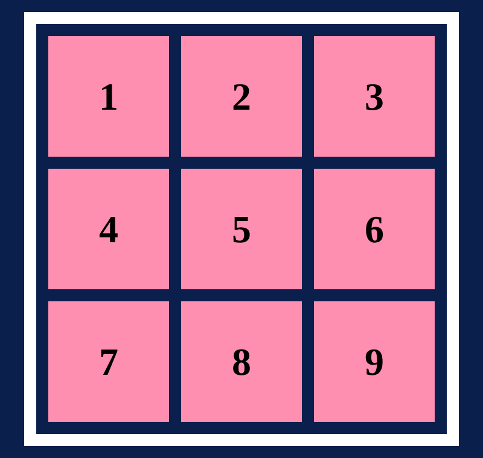

# ❌⭕ Tic Tac Toe Board

## 👋 Welcome!

Build a 3 by 3 board of pink squares with CSS Flexbox. Use JavaScript functions and event listeners so each square does something different when you click it. You are not building a full game.

## 🎯 Requirements

- [ ] The board is a 3 by 3 set of squares made with CSS Flexbox
- [ ] All nine cards are saved in variables
- [ ] Squares 1 to 5 use the functions from the starter
- [ ] Squares 6 to 9 each have a function you wrote
- [ ] Every square is connected with an event listener
- [ ] Every square does what the table below says
- [ ] Your code has comments
- [ ] You committed with meaningful messages and pushed to GitHub
- [ ] Your project is deployed to a Netlify URL

## 💎 What it should look like

Nine pink squares with bold black numbers 1 to 9, centered on a dark blue page inside a thick white border. You may use any colors you like.

## 🚀 Roadmap

### ⚙️ Fork and clone

1. Fork this repo. Use the fork and clone guide *(add link)*.
2. Clone **your fork** into your `dev` folder.
3. Open the `tic-tac-toe` folder in VS Code.

### ⚙️ Build

1. Style the board so it matches the picture.
2. Save each card in a JavaScript variable. Card 1 already has a second class as an example. Give the other cards one too.
3. Make each square do what the table says. Squares 1 to 5 already have a function. Write your own for squares 6 to 9.
4. Connect every square to its function with an event listener.
5. Comment your code.

| Square | When it is clicked |
| --- | --- |
| 1 | The console says "Square one was clicked!" |
| 2 | Its background turns white |
| 3 | The number 3 changes to the word "three" |
| 4 | Inside the function, make a variable called `message` that holds "This is the secret message for the 4th square." Log it to the console |
| 5 | It disappears. (The `.hidden` class in the CSS is for this.) |
| 6 | It gets a border |
| 7 | The text of Square 1 changes to anything you want |
| 8 | The background color of the page changes |
| 9 | All of the cards disappear |

### ⚙️ Commit, push and deploy

Commit every time something works, with a message that says what you did. Push to GitHub, then deploy to Netlify.
